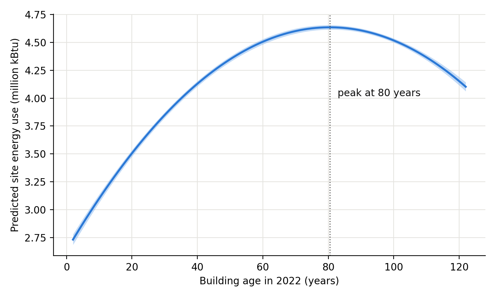

# Building Characteristics and Energy Use in New York City

A regression study of how floor area, building age and grid electricity use relate to the total site energy use of New York City buildings, built on the city's Local Law 84 (LL84) benchmarking disclosures and a normalized MySQL database.

*Academic project, Carnegie Mellon University, Fall 2025.* Full write-up: [`report/NYC_Building_Energy_Report.pdf`](report/NYC_Building_Energy_Report.pdf)



## Key findings

- **Floor area dominates.** Across 50,635 benchmarking records from 22,684 buildings, gross floor area alone explains about one-third of the variance in total site energy use (partial R² 0.32), and energy use rises with size at a decreasing rate.
- **Building age has an inverted-U effect.** Holding size and electricity use constant, predicted energy use rises with age up to about 80 years (buildings built around 1942) and then falls. Most of the sample is older than that peak.
- **Electricity use is secondary.** Grid electricity is significant in every model but adds little unique explanatory power (partial R² 0.03 to 0.04).
- **The polynomial model fits best** (R² 0.502, lowest AIC and BIC), ahead of the linear (0.477) and log-linear (0.472) models.

## Method

1. Cleaned an LL84 extract (24 fields): dropped records with missing modeling variables or text placeholders, kept year built in [1800, 2022], and removed outliers in grid electricity, site energy use and floor area with an iterative 3σ rule.
2. Loaded the cleaned records into a normalized MySQL database: a `Building` table, a `Benchmark_Record` table (a building can report in several records), and measurement tables keyed by record.
3. Fit linear, log-linear and polynomial (GFA², Age²) OLS models on z-scored variables and compared them by R², adjusted R², AIC and BIC.
4. Measured each predictor's unique contribution with partial R², grouping the squared terms with their linear terms, and derived the building age at which the polynomial model peaks.

## Repository contents

| Path | Contents |
|---|---|
| `report/NYC_Building_Energy_Report.pdf` | Project report |
| `analysis/clean_data.py` | Cleaning steps applied to an LL84 extract |
| `analysis/build_database.sql` | Builds the `building_energy` MySQL database from the cleaned data |
| `analysis/regression.py` | Models, partial R², age peak, and all tables and figures in the report |
| `data/nyc_ll84_cleaned.csv` | Cleaned dataset, one row per benchmarking record (50,635 rows) |
| `results/` | Tables written by `regression.py` |
| `figures/` | Figures written by `regression.py` |

To reproduce the results:

```bash
pip install -r analysis/requirements.txt
python analysis/regression.py --csv
```

To run from MySQL instead, build the database from the repository root and pass the connection through environment variables:

```bash
mysql --local-infile=1 -u <user> -p < analysis/build_database.sql
MYSQL_USER=<user> MYSQL_PASSWORD=<password> python analysis/regression.py
```

## Data sources

- Energy and building data: NYC Department of Buildings, [NYC Building Energy and Water Data Disclosure for Local Law 84](https://data.cityofnewyork.us/d/5zyy-y8am), NYC Open Data
- Weather normalization: U.S. EPA, [Portfolio Manager Technical Reference: Climate and Weather](https://www.energystar.gov/buildings/tools-and-resources/portfolio-manager-technical-reference-climate-and-weather)

## Notes

- The dependent variable is total weather-normalized site energy use, not energy use intensity, so part of the effect of floor area is mechanical. The report's limitations section discusses this and the other caveats (repeated records per building, electricity being part of total energy, heteroscedastic errors).
- The 3σ trimming removes the largest buildings; floor area in the cleaned sample ranges from 1,289 to 142,640 ft².
